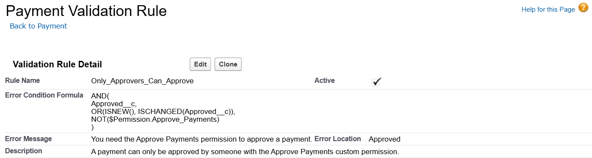
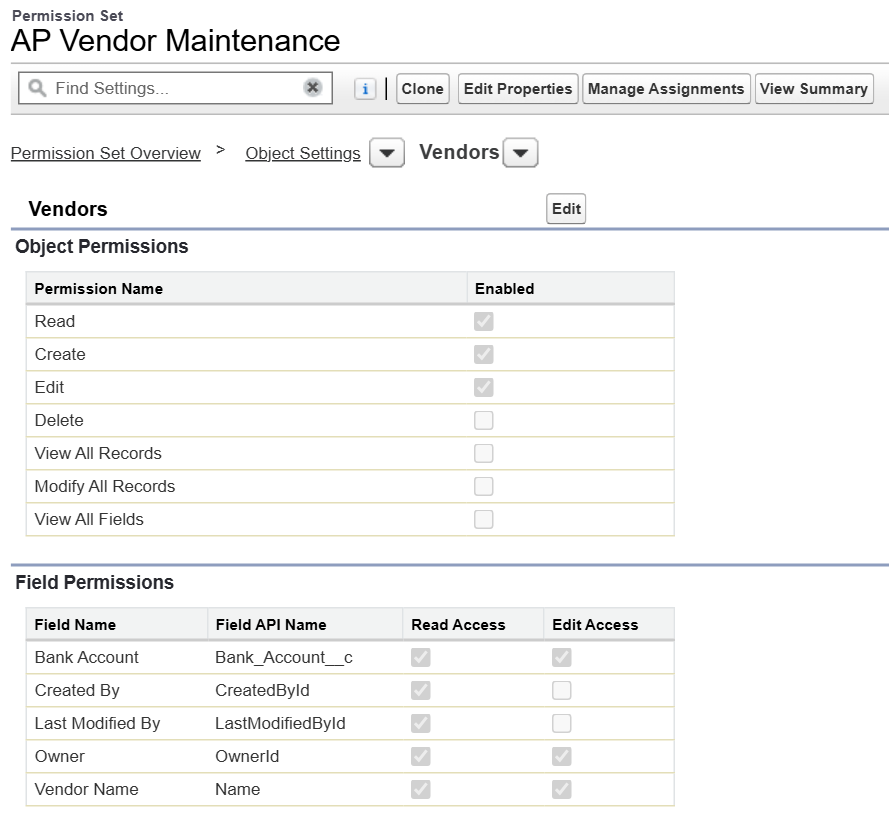
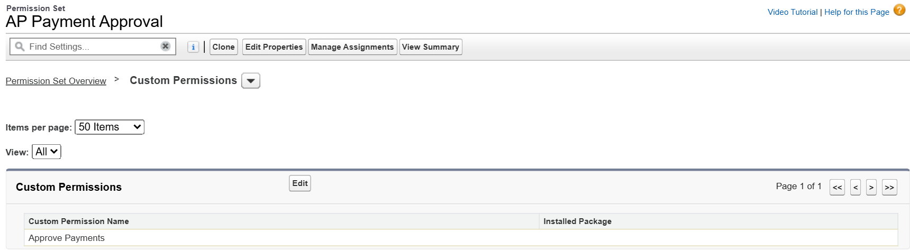

# access-governance-lab

Checking who can do what in a Salesforce org. This is a segregation of duties (SoD) conflict check and a role-to-permission matrix, built on a free Salesforce Developer Edition org with a small accounts payable setup. The findings, ratings and fixes are written up in the [risk report](reports/sod-risk-report.pdf).

## The lab org
force-app has the Salesforce metadata:
- Three custom objects for accounts payable: Vendor__c (with a bank account field), Invoice__c and Payment__c (with an Approved__c checkbox). Field history is on for the bank account and for Approved__c.
- An Approve_Payments custom permission and a validation rule on Payment__c, so only someone with that permission can approve a payment. I tested it with my admin account and it got blocked, which is what I wanted. Being an admin isn't the same as being an approver.
- Six permission sets: AP_Vendor_Maintenance, AP_Invoice_Entry, AP_Payment_Approval, Report_Export, View_All_Data and User_Admin. The last two wouldn't deploy at first, because View All Data and Manage Users need other permissions turned on with them.
- Five roles: AP_Clerk, AP_Manager, Vendor_Data, IT_Support and Sales_Analyst.
- Field access for the admin profile. Deploying the fields doesn't give anyone access to them, so my first query failed with "No such column" until I added this.



setup_lab.py creates six test users with a role and permission sets each. Some of them get access they shouldn't have on purpose, so the analyzer has something to find. One of them (cnguyen) left the company and was deactivated, but nobody removed their permission sets.

```
sf org login web --alias aglab
sf project deploy start --source-dir force-app --target-org aglab
python setup_lab.py
```

All the Python goes through the sf CLI (org.py), so the code never sees a password or token. It uses the aglab alias unless SF_TARGET_ORG says otherwise. The usernames use a made up domain and the results only show user aliases.

## Rules
rules/sod_rules.csv has six SoD rules. Each rule has two sides, and a user breaks it if they have at least one permission from each side. Permissions are written as short tokens:
- Vendor__c:create for object access
- Vendor__c.Bank_Account__c:edit for field access
- perm:ViewAllData for system permissions
- custom:Approve_Payments for custom permissions

For example SOD-02 is Vendor__c.Bank_Account__c:edit against custom:Approve_Payments. It's Critical because that person could change a vendor's bank account to their own and then approve the payment. AP_Vendor_Maintenance gives edit on the bank account and AP_Payment_Approval gives Approve Payments, so anyone with both of them breaks SOD-02.




rules/role_policy.csv lists which permission sets each role is allowed to have.

## How the analyzer works
```
python analyze.py --out reports/first-run
```

- It pulls every permission set assignment. In Salesforce every profile has a permission set behind it, so this gets profile access too. Permission set groups work the same way.
- It reads what each permission set grants (system, object, field and custom permissions) and adds it all up for each user, keeping track of where each permission came from. So a conflict says "custom:Approve_Payments from AP_Payment_Approval" and you know which assignment to remove.
- It writes user_matrix.csv (every user against every permission) and role_matrix.csv (what each role gets from the permission sets the policy allows).
- It checks every user against the SoD rules. It checks every role too, so a role that breaks a rule by design would show up.
- It also flags privileged system permissions, inactive users who still have permission sets, access outside the role policy and users that have no role in the policy.
- Frozen users show as frozen in the active column.

The tests don't need an org:

```
python test_analyze.py
```

output/ is the default results folder and it's in .gitignore, so only the runs in reports get pushed.

## First run
The first run found 10 SoD conflicts across 7 users and 13 other findings (reports/first-run). All the access I planted showed up. The worst was jpatel, an AP manager with vendor maintenance on top of payment approval, which breaks SOD-02.

It also found things I didn't plant:
- A second System Administrator (OEPIC) that came with the Developer Edition org. Nobody uses it, but it has full access.
- The Standard User and Standard Platform User profiles give Export Reports to everyone. That means my Report_Export permission set doesn't control anything, because Salesforce permissions only add up and a permission set can't take one away. Standard profiles can't be edited either.
- Salesforce's analytics integration user has View All Data from its locked profile.
- My admin account came with 5 extra permission sets for the AI features.

The admins only got flagged for SOD-04 and SOD-06, because they don't have the Approve Payments permission. But an admin can switch off the validation rule or give themselves AP_Payment_Approval, so in practice they can break every rule. The analyzer doesn't catch that, so it's its own finding in the report.

## Fixing it
reports/remediation-plan.csv lists each change: remove a permission set, freeze a user, or accept the risk with a reason. remediate.py carries it out. Without --apply it only prints what it would do.

```
python remediate.py
python remediate.py --apply
```

It removed six permission set assignments and froze OEPIC. I froze it instead of deactivating it in case the org needs it. My admin account and the integration user are accepted, with field history and the setup audit trail as the checks on the admin. Running it a second time changes nothing.

## After the fix
```
python analyze.py --out reports/after-fix
```

This run found 4 conflicts across 2 users, all Medium, and 6 other findings. Everything left is on the two admin accounts (OEPIC frozen, mine accepted) and the integration user, and nobody has access outside the role policy anymore. The Export Reports problem is still open. The fix is custom profiles without it, so Report_Export is the only way to get it.

## Risk report
[reports/sod-risk-report.pdf](reports/sod-risk-report.pdf) has the scope, method and rules, then a rating for each of the 10 findings (likelihood and impact), who owns it, the fix, what risk is left, and recommendations.

## Not covered
The analyzer looks at what a user can do, not which records they can see, so record sharing isn't covered. Apex and flows that run in system mode, and login settings like MFA, aren't covered either.
